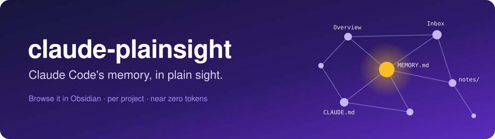
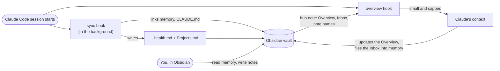

<p align="center">
  
</p>

<p align="center">
  <a href="https://github.com/antonis0490/claude-plainsight/actions/workflows/test.yml"></a>
  
  
  
  <a href="LICENSE"></a>
</p>

<p align="center">
  <b>See, search and edit what Claude Code remembers about each of your projects, right inside Obsidian.<br>
  Leave Claude notes. Keep a living overview per project. Pay almost nothing in tokens.</b>
</p>

---

Claude Code keeps a memory for every project in `~/.claude/projects/<project>/memory/`. It's useful, and it's invisible: you can't browse it, you can't see what's stale, and you can't easily tell Claude something between sessions.

**claude-plainsight** puts that memory in plain sight. It links each project's memory into an Obsidian vault, gives every project a hub note with a short Overview that Claude keeps current, and gives you an Inbox and a notes folder to talk back.

One Python file. Standard library only. Nothing to `pip install`.

## Highlights

- **Your memory, browsable.** Every project's memory appears in Obsidian as a real linked folder. Edit a note in Obsidian and Claude's memory changes, because it's the same file.
- **A living Overview per project.** Claude reads it at the start of every session and keeps it up to date. You read it in Obsidian to see where each project stands.
- **Notes for Claude.** Drop a quick line in a project's Inbox, or a full note in its `notes/` folder. Claude sees the Inbox and the note names at the next session start, and files what it learns into memory.
- **A dashboard of everything.** `Projects.md` lists every project with its Overview, open Inbox items and health status.
- **Memory health checks.** Broken `[[wikilinks]]`, notes missing from `MEMORY.md`, and anything that looks like a leaked API key, reported per project (secrets are masked in the report).
- **Near zero token cost.** Only the Overview, the Inbox and a list of note names enter Claude's context, each capped. An empty project adds nothing.
- **Safe to try, easy to remove.** A sandbox demo, a `--dry-run` install that shows the exact diff, and an uninstall that leaves your notes alone.

## Quick start

**1. Try the sandbox first.** It builds a vault with sample projects and touches nothing else on your machine.

```sh
git clone https://github.com/antonis0490/claude-plainsight
cd claude-plainsight
python3 plainsight.py demo
```

Open `plainsight-demo/vault` in Obsidian (*Open folder as vault*) and start with `Projects.md`.

**2. See exactly what install would change.**

```sh
python3 plainsight.py install --root ~/code --dry-run
```

**3. Install.**

```sh
python3 plainsight.py install --root ~/code
```

`--root` is a folder that holds your projects (repeat it for several). The vault defaults to `~/ClaudeVault`; pick another with `--vault`. Install links every project Claude Code already has memory for, so the vault isn't empty on day one. Then open the vault in Obsidian.

On Windows, use `py` or `python` instead of `python3`.

## How it works



Install adds two `SessionStart` hooks to your Claude Code `settings.json`, a short marked block to your user `CLAUDE.md` that tells Claude how to treat the hub notes, and the vault to `permissions.additionalDirectories` so Claude can update hub notes without asking every time (`--no-vault-access` skips that). The script and its config are copied into `<vault>/.plainsight/`, so you can delete the clone afterwards.

At session start, Claude sees something like this, and nothing else:

```text
[claude-plainsight] Hub note: ~/ClaudeVault/projects/harbor-api/harbor-api.md

Project overview:
REST API for booking boat slips at small marinas. FastAPI and Postgres on Fly.io.
State: v1 is live at two marinas; payments sit behind a feature flag.
Next: Stripe payouts, then the waiting list endpoint.

Inbox (notes the user left for you in Obsidian):
- The Kalamaki marina wants SMS reminders, not email. Check whether Twilio fits the budget.
- I prefer one migration per PR.

The user's notes for this project, in ~/ClaudeVault/projects/harbor-api/notes (read them when relevant):
- meetings/2026-10-12 Kalamaki.md
- launch-checklist.md
```

## What you get in the vault

```text
ClaudeVault/
├── Projects.md              dashboard of every project, refreshed each session
├── projects/
│   └── harbor-api/
│       ├── harbor-api.md    hub note: Overview + Inbox (created once, never overwritten)
│       ├── memory/          link to Claude's memory for this repo
│       ├── notes/           your notes; Claude sees their names, reads them when relevant
│       ├── CLAUDE.md        link to the repo's CLAUDE.md
│       └── _health.md       lint report, refreshed each session
└── shared/
    └── CLAUDE.md            link to your user CLAUDE.md
```

Claude Code keeps one memory per git repository: sessions in a subfolder or a worktree share the main repo's memory, and claude-plainsight follows the same rule. If a project folder holds several repos of its own (say `studio/site/` and `studio/portal/`), each gets its own `memory-site/`, `memory-portal/` link.

## Talking to Claude from Obsidian

| You want to... | Do this | Claude... |
| --- | --- | --- |
| Tell Claude a quick fact or preference | Add a line under `## Inbox` in the hub note | sees it at the next session start, saves it to memory, removes it from the Inbox |
| Ask for something to be done | Add it to the Inbox | mentions it to you, and acts when you ask or when it fits the current task |
| Keep longer notes (plans, meeting notes, checklists) | Create any note in the project's `notes/` folder | sees the file name at session start and reads the note when relevant; never edits it unless asked |
| Correct something Claude remembered | Edit the file in `memory/` directly | uses the corrected memory from then on |
| See where a project stands | Read the Overview, or `Projects.md` for all of them | keeps the Overview current as the project moves |

## Commands

| Command | What it does |
| --- | --- |
| `demo [--path DIR]` | Build a sandbox vault with sample projects. Touches nothing outside `DIR`. |
| `install --root DIR [--vault PATH] [--dry-run] [--no-vault-access]` | Set everything up and link existing projects. Safe to run again. |
| `sync [--all]` | Link the current session's project (run by the hook). `--all` links every project under your roots. |
| `overview` | Print what Claude sees at session start (run by the hook). Prints nothing for an empty project. |
| `lint [--project NAME]` | Read only. Report broken links, notes missing from `MEMORY.md` and likely credentials. |
| `doctor` | Check the config, hooks, `CLAUDE.md` block, vault access and links, and say what's wrong. |
| `uninstall` | Remove everything claude-plainsight added. Keeps your notes, hub notes and Claude's memory. |

After install, run commands through the installed copy, for example:

```sh
python3 ~/ClaudeVault/.plainsight/plainsight.py doctor
```

## FAQ

<details>
<summary><b>Will this mess up my current Claude Code setup?</b></summary>

It makes three small, reversible changes: two hooks in `settings.json`, one marked block in your user `CLAUDE.md`, and one entry in `permissions.additionalDirectories`. Run `install --dry-run` to see the exact diff first, or `demo` to try everything in a sandbox. `uninstall` removes exactly those changes and nothing else.
</details>

<details>
<summary><b>Does it copy, move or rewrite my memory files?</b></summary>

No. The vault holds links (symlinks, or junctions for folders on Windows) to the real files. Nothing is copied, so the vault can never drift from what Claude actually uses. Lint is read only.
</details>

<details>
<summary><b>How many tokens does it cost?</b></summary>

Only what's in the hub note. The Overview and the Inbox are each capped at 2000 characters, the notes list at 30 names, and an empty project adds nothing at all. Note contents are never loaded unless Claude decides one is relevant and reads it.
</details>

<details>
<summary><b>Can I use my existing Obsidian vault?</b></summary>

Yes: `install --vault /path/to/your/vault`. Everything goes under `projects/`, `shared/`, `Projects.md` and a hidden `.plainsight/` folder. A separate vault keeps Claude's world apart from your own writing, which many people prefer.
</details>

<details>
<summary><b>Does Claude edit my notes?</b></summary>

It's told to edit only the Overview and Inbox sections of hub notes, and to leave `notes/` alone unless you ask. Hub notes are created once and never overwritten by the tool.
</details>

<details>
<summary><b>What does it look for when it flags credentials?</b></summary>

Common key formats (Anthropic and OpenAI style `sk-` keys, AWS, GitHub, Slack, Google, Stripe, private key blocks, JWTs) and assignments like `api_key = ...`. Text in `<angle brackets>` is treated as a placeholder and ignored. Reports show only the first four characters.
</details>

<details>
<summary><b>Windows?</b></summary>

Supported and tested in CI. Folder links are junctions, which need no admin rights. Linking a single file such as `CLAUDE.md` needs Developer Mode or admin rights; without them that one link is skipped with a notice in `_health.md`. It's never copied instead.
</details>

<details>
<summary><b>How do I remove it?</b></summary>

```sh
python3 ~/ClaudeVault/.plainsight/plainsight.py uninstall
```

Hooks, the `CLAUDE.md` block, the vault access entry, links, `_health.md`, `Projects.md` and `.plainsight/` go. Hub notes, your notes and Claude's memory stay.
</details>

## Development

```sh
python3 -m unittest discover -s tests -v
```

The tests run against a temporary `CLAUDE_CONFIG_DIR` and temporary folders, and clean up after themselves. CI runs them on macOS, Linux and Windows across Python 3.8 to 3.13. Issues and pull requests are welcome; please keep it to one file and the standard library.

## License

MIT. See [LICENSE](LICENSE).

claude-plainsight is an independent community project. It is not made by or affiliated with Anthropic or Obsidian.
